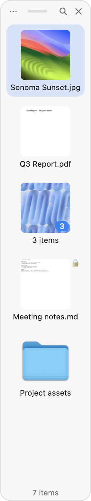
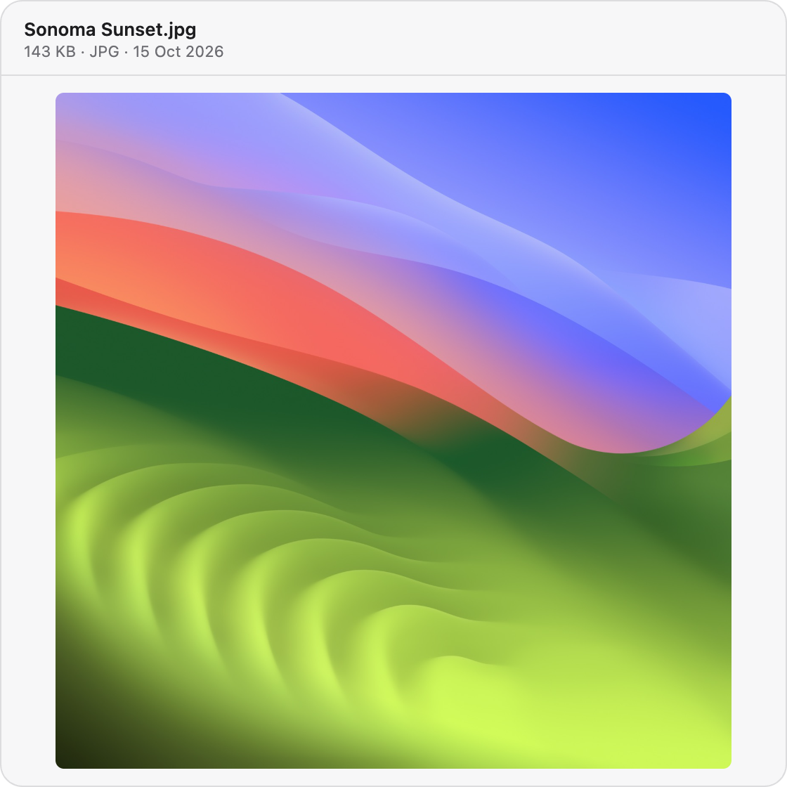
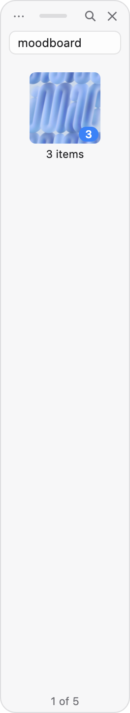
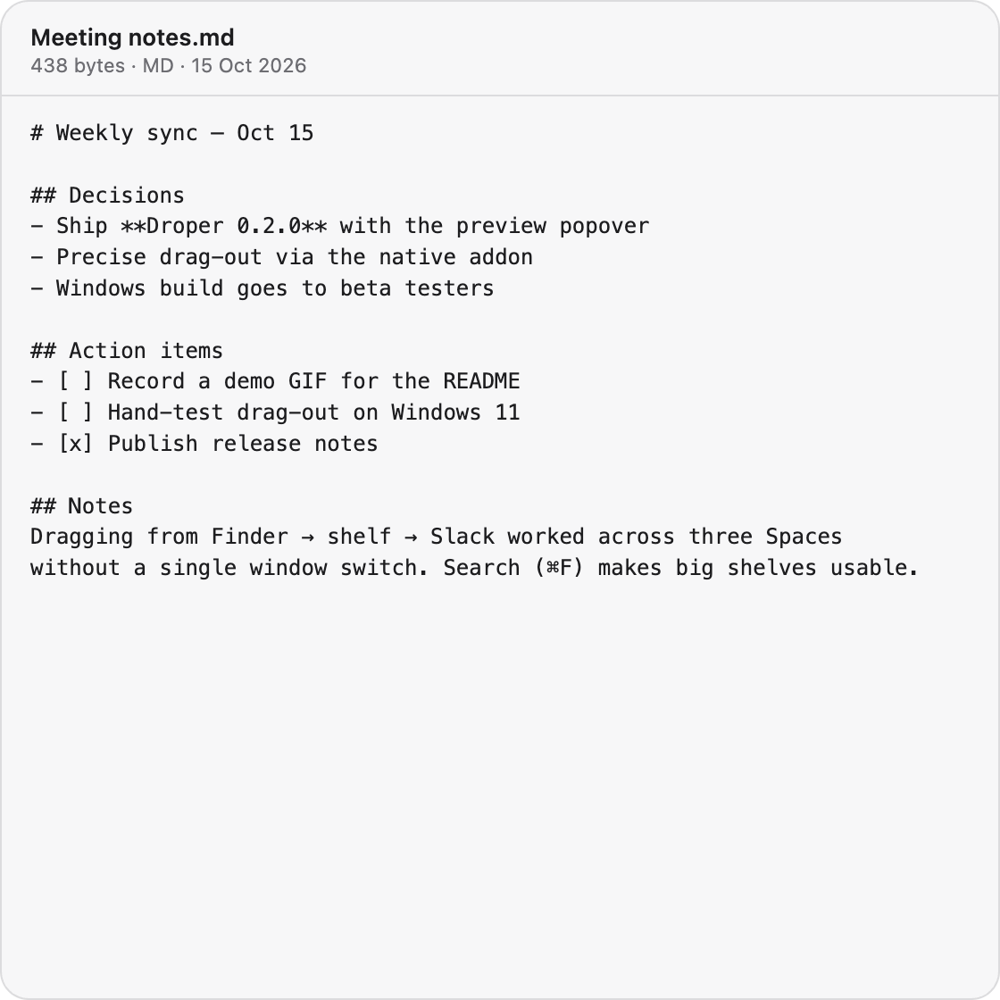
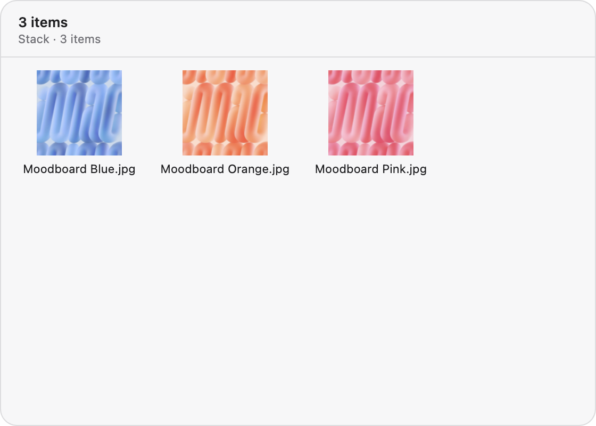
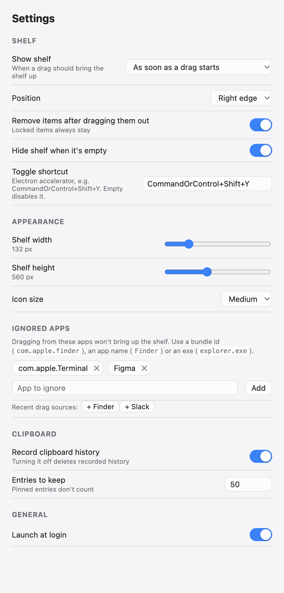
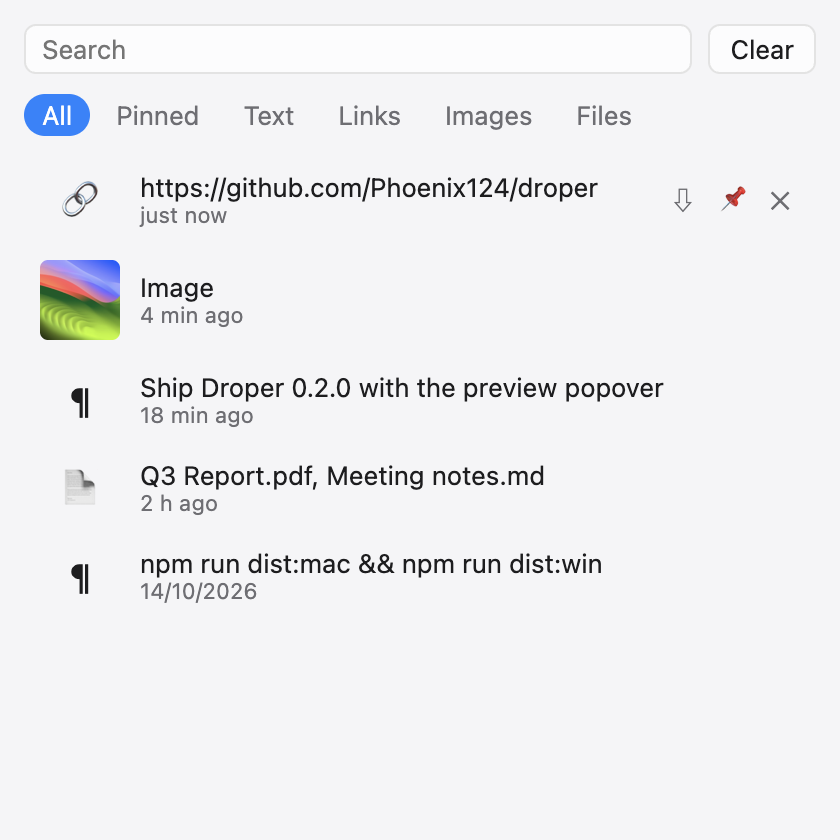

<div align="center">


# Droper

**A drag & drop shelf for macOS and Windows.**<br>
Start dragging, drop it on the shelf, take your time, drag it out wherever it belongs.


**English** · [Русский](README.ru.md)

</div>

<table>
  <tr>
    <td align="center" valign="top">
      <picture>
        <source media="(prefers-color-scheme: dark)" srcset="docs/screenshots/shelf-dark.png">
        
      </picture>
      <br><sub><b>The shelf</b></sub>
    </td>
    <td align="center" valign="top">
      <picture>
        <source media="(prefers-color-scheme: dark)" srcset="docs/screenshots/preview-image-dark.png">
        
      </picture>
      <br><sub><b>Space to preview</b></sub>
    </td>
    <td align="center" valign="top">
      <picture>
        <source media="(prefers-color-scheme: dark)" srcset="docs/screenshots/shelf-search-dark.png">
        
      </picture>
      <br><sub><b>⌘F to search</b></sub>
    </td>
  </tr>
</table>

## ✨ Features

| | |
|---|---|
| 🪄 **Shows up when you drag** | When a drag starts, at the screen edge, or under the pointer. On macOS it reacts only to real drag sessions, not text selection or window moves. |
| 📦 **Takes anything** | Files and folders (kept as references; *Keep a Copy* stores a copy so an item survives the original moving), text → `.txt`, links → `.webloc` / `.url`, images straight from the browser. |
| 🎯 **Precise drag-out** | A native addon asks the OS whether the target app accepted the files. Cancelled or refused drops leave items where they are. |
| 🗂️ **Stacks** | Merge items into one stack, drag it out in one go, split it back. |
| 👀 **Preview** | <kbd>Space</kbd> opens a popover next to the shelf: images, PDF, text, video, audio, Quick Look thumbnails, folders, stacks. |
| 🔍 **Search** | <kbd>⌘F</kbd> / <kbd>Ctrl+F</kbd> filters by name and path. |
| 🗑️ **Clean up** | *Move to Trash* deletes the files behind selected items; the menu-bar icon shows how many items are waiting. |
| 🔒 **Lock & undo** | Locked items stay after drag-out. *Restore Removed Items* brings back the last removal. |
| 🙈 **Ignored apps** | No shelf for drags from apps you choose, with one-click buttons for recent drag sources. |
| 📐 **Your size** | Shelf width, height and icon size, applied live. |
| 📸 **Screenshots** | Optional. New screenshots land on the shelf as soon as they are saved. |
| 📋 **Clipboard history** | Optional. Text, links, images and files with pins, search and filters. |
| 🔗 **Automation** | `droper://` links for Shortcuts, Alfred, Raycast or scripts. |
| ⚙️ **Fits in** | Menu bar / tray (drop files or text on the menu-bar icon on macOS), global shortcut, launch at login, Explorer *Send to → Droper*. |

## ⌨️ Keyboard

| Key | Action |
|---|---|
| <kbd>Space</kbd> | Preview the selected item (again to close) |
| <kbd>↑</kbd> <kbd>↓</kbd> | Move through items; the preview follows |
| <kbd>⌘F</kbd> / <kbd>Ctrl+F</kbd> | Search the shelf |
| <kbd>Enter</kbd> | Open |
| <kbd>⌫</kbd> / <kbd>Delete</kbd> | Remove from the shelf |
| <kbd>⌘A</kbd> / <kbd>Ctrl+A</kbd> | Select all |
| <kbd>Esc</kbd> | Close preview → search → shelf |
| <kbd>⌘⇧Y</kbd> / <kbd>Ctrl+Shift+Y</kbd> | Show or hide the shelf from anywhere |

## 🖼️ More screenshots

<table>
  <tr>
    <td align="center" valign="top">
      <picture>
        <source media="(prefers-color-scheme: dark)" srcset="docs/screenshots/preview-text-dark.png">
        
      </picture>
      <br><sub>Text preview</sub>
    </td>
    <td align="center" valign="top">
      <picture>
        <source media="(prefers-color-scheme: dark)" srcset="docs/screenshots/preview-stack-dark.png">
        
      </picture>
      <br><sub>Stack preview</sub>
    </td>
  </tr>
  <tr>
    <td align="center" valign="top">
      <picture>
        <source media="(prefers-color-scheme: dark)" srcset="docs/screenshots/settings-dark.png">
        
      </picture>
      <br><sub>Settings</sub>
    </td>
    <td align="center" valign="top">
      <picture>
        <source media="(prefers-color-scheme: dark)" srcset="docs/screenshots/clipboard-dark.png">
        
      </picture>
      <br><sub>Clipboard history</sub>
    </td>
  </tr>
</table>

## 💾 Install

Grab the latest build from [**Releases**](../../releases).

| Platform | File | First launch |
|---|---|---|
| 🍎 macOS (Apple Silicon) | `Droper-<version>-arm64.dmg` | Unsigned: see [below](#-first-launch-on-macos), then allow **Accessibility** when asked |
| 🪟 Windows (Intel / AMD) | `Droper-Setup-<version>-x64.exe` | Unsigned: SmartScreen → **More info → Run anyway** |
| 🪟 Windows (ARM) | `Droper-Setup-<version>-arm64.exe` | Same as above |

> [!NOTE]
> Accessibility lets Droper see global mouse drags. Without it the shelf still works, but only through the shortcut or menu.

### 🍎 First launch on macOS

Droper isn't signed by Apple yet, so macOS blocks it the first time. Either:

- **System Settings:** open Droper once, then go to **System Settings → Privacy & Security** and click **Open Anyway** next to the Droper message.
- **Terminal:** after copying Droper to Applications, clear the download quarantine flag:

  ```bash
  xattr -dr com.apple.quarantine /Applications/Droper.app
  ```

Only do this for builds downloaded from this repository's Releases, after checking them against `SHA256SUMS.txt`.

## 🔗 Automation (`droper://`)

| Link | Does |
|---|---|
| `droper://show` · `hide` · `toggle` | Show, hide or toggle the shelf |
| `droper://add?path=/Users/me/a.pdf&path=/Users/me/b.png` | Add files (repeat `path`) |
| `droper://add-text?text=Hello` | Add a text snippet |
| `droper://add-url?url=https://example.com&title=Example` | Add a link |
| `droper://clear` · `restore` | Clear the shelf / bring back the last removal |

```bash
open "droper://add?path=$PWD/report.pdf"        # macOS
start "" "droper://add-text?text=Call%20Anna"  # Windows
```

<details>
<summary><b>🛠️ Development</b></summary>

```bash
npm install       # also builds the native drag addon
npm test          # core unit tests (vitest)
npm start         # build + run
npm run dist:mac  # release/Droper-<ver>-arm64.dmg
npm run dist:win  # release/Droper-Setup-<ver>-x64.exe and -arm64.exe
```

Pushing a `v*` tag makes GitHub Actions build both platforms and attach them to a draft release.

</details>

<details>
<summary><b>🏗️ Architecture</b></summary>

```
src/core/      pure logic without Electron, covered by tests
  shelfStore       items, stacks, lock, remove/restore, prune
  dragDetector     mouse down/move/up → "show the shelf"
  dragOut          whether a drag-out should remove items
  ingest           dropped text/links/images → files
  clipboardHistory clipboard history
  settings         validated settings
  preview          preview kind and popover placement
  urlScheme        droper:// parsing
  ignoredApps      ignore-list matching
src/main/      Electron main: panels, tray, IPC, mouse hook, clipboard
src/preload/   contextBridge APIs
src/renderer/  shelf, preview, settings and clipboard UI (vanilla TS)
native/        N-API addon: native drag-out and app-under-pointer
```

**Telling a real drag from a text selection or window move.** On macOS a background JXA process watches the system drag pasteboard; the shelf appears only when an app actually starts a drag session. Windows has no equivalent, so it defaults to "drag to the screen edge", and an empty shelf hides itself again.

**Precise drag-out.** macOS uses `NSDraggingSession` and reads the operation from `draggingSession:endedAtPoint:operation:`. Windows uses `SHDoDragDrop` with `CF_HDROP` and honours `CFSTR_PERFORMEDDROPEFFECT` for Explorer's optimized moves. Without the addon Droper falls back to judging by where the mouse was released.

</details>

## ⚠️ Known limitations

- 🧪 The Windows build passes CI but hasn't been hand-tested yet.
- ☁️ No Handoff / iCloud, Services menu or widgets.
- 📄 On Windows, *Copy* puts file paths on the clipboard as text.
- 🖼️ The preview is Droper's own popover, so formats without a thumbnail generator show their icon.
